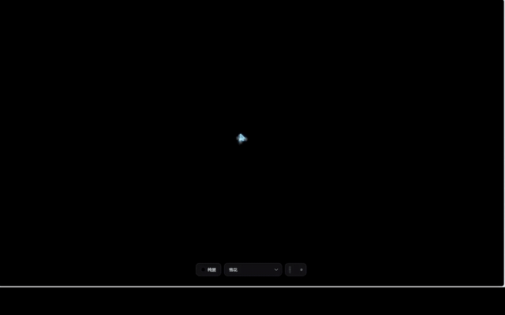
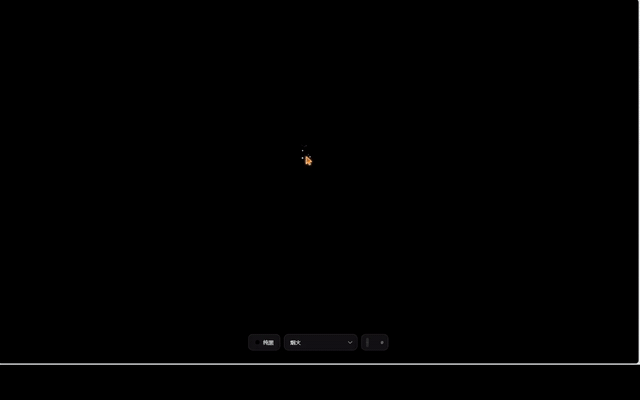
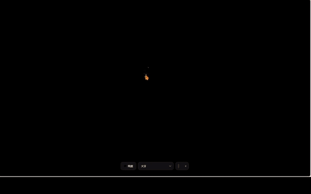
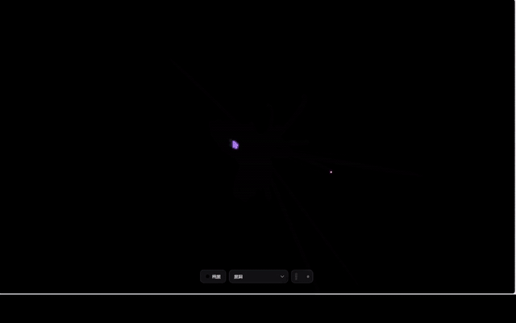

<div align="center">

# CursorKit

**给你的页面装上会呼吸的光标**

25 套鼠标光标动效，封装为零依赖 Web Component。原生 Canvas 绘制，一行 `import` 接入，Vue / React / Next.js 与纯 HTML 通吃。

[在线演示](https://cursor.lxpavilion.top/) &nbsp;·&nbsp; [纯净展示页](https://cursor.lxpavilion.top/show.html)

|  |  |
|:---:|:---:|
|  |  |

</div>

## 用法

引入动效模块会自行注册自定义元素，然后在页面任意位置放一个标签。主题光标默认开启，宿主页面无需任何配置。

```html
<script type="module">
  import './src/effects/snow.js';
</script>

<cursor-snow></cursor-snow>
```

`snow` 换成任意效果名即可，只用哪个就只引入哪个。`registerAll()` 一次注册全部。

<div align="center">

| | | | | | |
|:---|:---|:---|:---|:---|:---|
| `snow`<br><sub>雪花</sub> | `ice`<br><sub>冰晶</sub> | `pixel`<br><sub>像素</sub> | `sun`<br><sub>太阳</sub> | `silk`<br><sub>丝绸</sub> | `refract`<br><sub>光折射</sub> |
| `orb`<br><sub>光球</sub> | `geom`<br><sub>几何</sub> | `ball`<br><sub>弹球</sub> | `planet`<br><sub>星球</sub> | `mist`<br><sub>迷雾</sub> | `code`<br><sub>代码</sub> |
| `rainbow`<br><sub>彩虹</sub> | `moon`<br><sub>月亮</sub> | `bubble`<br><sub>气泡</sub> | `ink`<br><sub>墨迹</sub> | `doodle`<br><sub>涂鸦</sub> | `firefang`<br><sub>火牙</sub> |
| `hole`<br><sub>黑洞</sub> | `lightning`<br><sub>闪电</sub> | `kaleido`<br><sub>万花筒</sub> | `cell`<br><sub>细胞</sub> | `fish`<br><sub>鱼群</sub> | `firework`<br><sub>烟花</sub> |
| `radar`<br><sub>雷达</sub> | | | | | |

<sub>`no-cursor` / `no-wheel` 可关掉主题光标与滚轮动效，变化实时生效 · JS 里对应 `fx.cursorEnabled` 与 `fx.wheelEnabled` · 图层层级用 `--cursor-effect-z` 覆盖</sub>

<sub>[MIT](./LICENSE)</sub>

</div>
